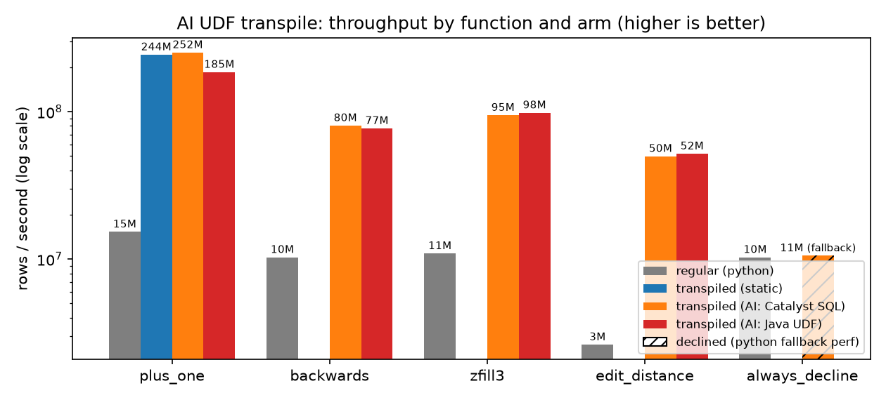

# AI UDF transpile

Partial, non-blocking Python UDF transpilation for Apache Spark. Spark's
built-in Catalyst transpiler covers simple functions; this plugin asks an
agent (CoCo / Pi / Claude / Codex / Cursor, or a deterministic fake backend
in CI) to rewrite the rest into Catalyst SQL or a Java UDF, then
Hypothesis-checks the rewrite against the original Python before it is served.

Queries never wait on the agent. A miss inserts a `pending` catalog row and
Spark keeps the interpreted Python UDF. A background worker (inline driver
thread by default, or `python -m ai_udf_transpile.worker`) fills the cache.

Targets **classic Spark master** (the `AbstractTranspiler` hook landed for
4.3 / current master). Connect is not supported. This is experimental.

## Don't use this code (yet)

A working experiment, not a dependency:

- **The hook itself is unreleased.** Targets Spark master (4.3+); Spark's
  ANSI path skips array-return UDFs before the `ai` transpiler ever runs
  (SPARK-55206).
- **Verification is value-equality, not proof.** Hypothesis samples inputs
  and compares outputs at a tolerance; a wrong-but-lucky rewrite can pass.
  The vacuous-pass traps (python raises on every example, SQL returns
  anything) are closed, but "verified" means "matched every sampled input",
  not "faithful".
- **Generated code runs in your driver.** The rewrite is SQL you execute
  and, for java UDFs, javac output loaded into the session. The CLI
  backends write into a sandbox directory — that is a work dir, not a
  security boundary. Same trust hole in the shared write-back table:
  anyone who can append to it runs SQL and Java in every reader's driver.
- **Benchmarks are honest but narrow.** Single node, fake backend, five
  functions, min of 3. The graph below is that run, not a promise about
  your cluster.
- **Fail-open everywhere.** A misconfigured catalog or unreachable backend
  never breaks UDF definition — which also means misconfiguration is
  silent.

## Install

```bash
pip install -e ".[dev]"
export SPARK_HOME=/path/to/spark-master   # package-only build, tests skipped
export PYTHONPATH="$SPARK_HOME/python:$(ls $SPARK_HOME/python/lib/py4j-*-src.zip | head -n1)"
```

PyPI PySpark is not used for integration tests until 4.3+ is the pinned
target; CI builds Spark from `apache/spark@master` with `-DskipTests`.

## Usage

```python
from pyspark.sql import SparkSession
from ai_udf_transpile import enable, register_impl

spark = SparkSession.builder.getOrCreate()
spark.conf.set("spark.sql.ansi.enabled", "true")
enable(spark, backend="fake")  # or coco / pi / claude / codex / cursor / auto

from pyspark.sql.functions import udf
from pyspark.sql.types import LongType


def plus_one(x: int) -> int:
    return x + 1


f = udf(plus_one, LongType())  # first call: Python path; worker may fill cache
```

Types must be known: every public parameter needs a recognized annotation
(`int` / `float` / `str` / `bool` / `bytes` / `datetime`, or `list[...]` /
`dict[...]` for array/map inputs) and `udf(..., returnType)` must be an
atomic Spark type. `numeric`, `string`, `bool`, and `binary` inputs engage
by default; `timestamp`, `map`, and `array` inputs engage only when
`spark.sql.experimental.aiUdfTranspile.inputCategories` opts in. Untyped
UDFs are ignored by this plugin (Spark's built-in `catalyst` transpiler
may still try them).

Human-provided rewrite (skips the agent):

```python
register_impl(
    spark,
    plus_one,
    kind="catalyst",
    catalyst_sql="_udf_param_0 + 1",
    return_type=LongType(),
)
```

Standalone worker when `inlineWorker` is false:

```bash
python -m ai_udf_transpile.worker --sqlite-path /tmp/ai_udf_transpile.sqlite --backend fake
```

## Demos & benchmarks

```bash
examples/run_demos.sh           # quickstart + full demo (fake backend)
examples/run_demos.sh --bench   # + local micro benchmarks
examples/run_demos.sh --live    # + real CLI backends (cortex/pi/agent/claude/codex on PATH)
examples/run_demos.sh --bench --transpilation-timing-csv bench_transpilation_timing.csv
examples/run_demos.sh --bench --rust-accel
examples/setup_comet.sh --write-env-file .comet-env && source .comet-env
```

The runner wires up `SPARK_HOME` (default `~/spark`), the py4j zip, and a
matching `PYSPARK_PYTHON` itself. `examples/demo_quickstart.py` is the
60-second version (one Catalyst rewrite, one Java UDF); `examples/demo.py`
is the full tour including the adversarial pack. `examples/demo_transpile_inspect.py`
shows what each UDF was transpiled to (the actual SQL/Java), how many
worker attempts it took, and a multi-agent comparison where several
candidate rewrites for the same UDF are run through Hypothesis to show
which ship and which get rejected. `examples/bench_micro.py`
measures up to four arms per function —
regular Python, transpiled static (Spark's built-in `catalyst` transpiler,
which converts only simple operations like `plus_one`; everything else
declines and gets no static number), transpiled AI as Catalyst SQL, and
transpiled AI as a Java UDF (compiled on the driver; a target for every
convertible benched UDF, not just one) — over 10M cached rows (noop
sink, plan-checked). Its CSV is one row per function with per-arm
rows/sec, speedup vs regular, and `transpile_succeeded` booleans for
static and both AI kinds. A second transpilation timing CSV (auto-written when
`--csv` is set, or explicit via `--transpilation-timing-csv`) captures one-time transpile fill costs
and plain-vs-AI UDF lookup/definition costs. `--rust-accel` runs the same
bench with rust acceleration Spark configs enabled (default preset: Comet; add
`--rust-accel-conf key=value` for local overrides). For the Comet preset, set
`AI_UDF_TRANSPILE_COMET_JAR` (or `COMET_JAR`) so the plugin jar is on Spark's
classpath; `examples/setup_comet.sh` can clone/build Comet from source and emit
the exports for your current Spark checkout.

The perf graph is generated from that CSV by a CLI tool
(`examples/bench_graph.py`, matplotlib — no AI in the loop, ever):



Regenerate it the same way the committed PNG was made — a 10M-row,
min-of-3 local run against a Spark checkout with the transpiler surface
(here `upstream/branch-4.x`; master works too). CI uploads the same CSV
from its reduced-settings run as the `bench-micro-csv` artifact, so the
second command re-plots that one too:

```bash
examples/run_demos.sh --bench --csv bench_micro.csv   # or: python examples/bench_micro.py --csv bench_micro.csv
python examples/bench_graph.py bench_micro.csv docs/bench_perf.png
```

`backend=auto` picks the first available backend from
`spark.sql.experimental.aiUdfTranspile.autoBackendPriority`
(default: `coco,pi,claude,codex,cursor`). Override binaries with
`spark.sql.experimental.aiUdfTranspile.binary.<name>` and models with
`spark.sql.experimental.aiUdfTranspile.model.<name>`, where `<name>` is one of
`coco`, `pi`, `claude`, `codex`, or `cursor`.

## Catalog

Default catalog is **SQLite** (real `UPDATE` CAS; claims, cooldowns, and
samples stay local by design). The shared path is **write-back to an
Iceberg table served by Apache Polaris or any other Iceberg REST
catalog**: configure that catalog in Spark, set
`spark.sql.experimental.aiUdfTranspile.writebackTable` to the
fully-qualified table (e.g. `polaris.db.ai_udf_writeback`) plus
`writebackFormat=iceberg` (Iceberg runtime on the classpath; `parquet`
works where no catalog is available) and optional `writebackThreshold`,
default 32. Verified successes stage in SQLite, then append to the shared
table once the threshold accumulates. Lookups fall through to the table,
so a fresh process (new SQLite file) is served verified rewrites without
running a backend. Write-back is append-only (reads dedupe by latest
`updated_at`), carries successes only, and is fail-open: a misconfigured
or unreachable catalog never breaks UDFs. `catalog=delta` (Delta Lake
on the classpath) still exists but is no longer the shared story.
Trust caveat: a served row is served as-is (no re-verification), so anyone
who can append to that table can run SQL and Java in every reader's driver
(see `docs/future-iceberg-udf-catalog.md`).

Failed rewrites cool down for 24h (`failCooldownSeconds`) and stop retrying
after `maxRetries` (default 3).

## Tests

```bash
pytest -m "not spark" tests/   # no JVM
SPARK_HOME=/path/to/spark-master pytest tests/   # plus classic SparkSession tests
```

The Spark tests need a package-only build of `apache/spark@master`
(`./build/mvn -DskipTests -Phadoop-3 package -pl sql/core,assembly -am`).
`tests/conftest.py` puts `$SPARK_HOME/python` and py4j on `sys.path` and pins
`PYSPARK_PYTHON` to the running interpreter so workers match the driver.

CI uses `backend=fake` with a handful of annotated fixtures (`plus_one`,
`is_none_branch`, `both_positive`, `greet`). Live CoCo/Cursor/Claude CLIs
are not invoked in default GHA.
