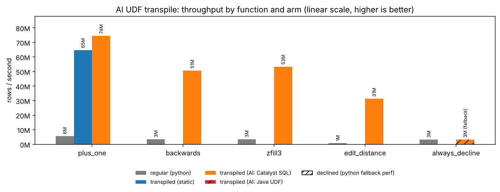
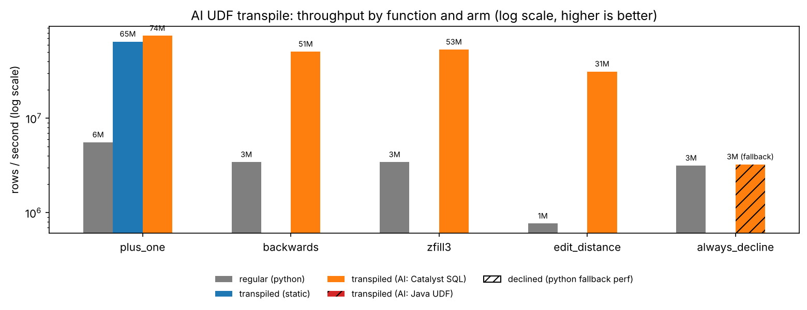
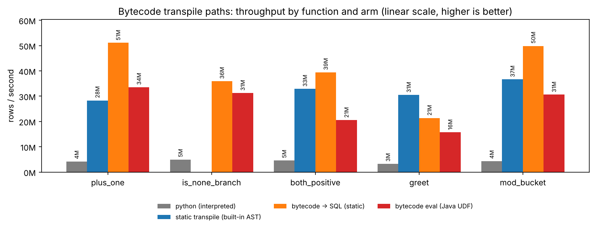
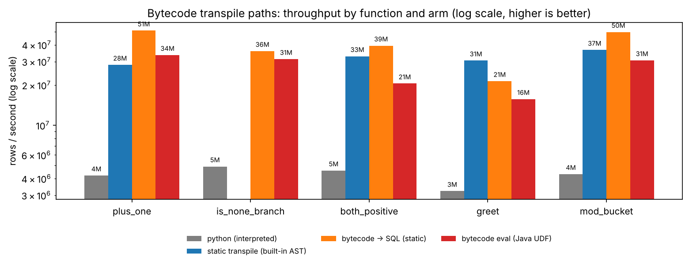

# AI UDF transpile

Partial, non-blocking Python UDF transpilation for Apache Spark. Spark's
built-in Catalyst transpiler covers simple functions; this plugin asks an
agent (CoCo / Pi / Claude / Codex / Cursor; a deterministic fake backend
stands in for tests only) to rewrite the rest into Catalyst SQL or a Java UDF
(or, opt-in under Comet, a native Rust UDF), then
Hypothesis-checks the rewrite against the original Python before it is served.

Queries never wait on the agent. A miss inserts a `pending` catalog row and
Spark keeps the interpreted Python UDF. A background worker (inline driver
thread by default, or `python -m ai_udf_transpile.worker`) fills the cache.

Targets **classic Spark master** (the `AbstractTranspiler` hook landed for
4.3 / current master). Connect is not supported. This is experimental.

## Don't use this code (yet)

A working experiment, not a dependency:

- **The hook itself is unreleased.** Targets Spark master (4.3+); Spark's
  ANSI path skips array-return UDFs before the `ai` transpiler ever runs
  (SPARK-55206).
- **Verification is value-equality, not proof.** Hypothesis samples inputs
  and compares outputs at a tolerance; a wrong-but-lucky rewrite can pass.
  The vacuous-pass traps (python raises on every example, SQL returns
  anything) are closed, but "verified" means "matched every sampled input",
  not "faithful". String columns are not invented: a string may hold a
  date, JSON, or a number. Set
  `spark.sql.experimental.aiUdfTranspile.partyOnStrings` to generate
  string values anyway. And for service-calling UDFs the gate is only as
  strong as the verification env: with the service unreachable, a
  NULL-guarded function (return None on NULL, call the service otherwise)
  supplies the one successful python eval the vacuous-pass guard needs,
  and every service-calling row is a python-raise + sql-value allowance --
  so a hallucinated rewrite of `kms_encrypt` verifies in an env without
  AWS credentials. Verification cannot refute a service it cannot reach;
  do not serve rewrites of service-calling UDFs from such an env, or set
  `requireApproval=network` so a person signs them off first (see
  [Manual approval](#manual-approval)).
- **Generated code runs in your driver.** The rewrite is SQL you execute
  and, for java UDFs, javac output loaded into the session. The CLI
  backends write into a sandbox directory — that is a work dir, not a
  security boundary. Same trust hole in the shared write-back table:
  anyone who can append to it runs SQL and Java in every reader's driver.
- **Benchmarks are honest but narrow.** Single node, one AI backend, five
  functions, min of 3. The graph below is that run, not a promise about
  your cluster.
- **Fail-open everywhere.** A misconfigured catalog or unreachable backend
  never breaks UDF definition — which also means misconfiguration is
  silent.
- **Except the opt-in `rust` target.** A Rust rewrite runs only inside
  Comet's native execution; a query whose operator Comet does not take
  fails instead of falling back to Python — including any query that puts a
  Rust-served UDF beside a still-interpreted Python UDF. Off by default; read
  [Rust target](#rust-target-comet-native-udfs-opt-in) before turning it on.

## Install

```bash
pip install -e ".[dev]"
export SPARK_HOME=/path/to/spark-master   # package-only build, tests skipped
export PYTHONPATH="$SPARK_HOME/python:$(ls $SPARK_HOME/python/lib/py4j-*-src.zip | head -n1)"
```

PyPI PySpark is not used for integration tests until 4.3+ is the pinned
target; CI builds Spark from `apache/spark@master` with `-DskipTests`.

## Usage

```python
from pyspark.sql import SparkSession
from ai_udf_transpile import enable, register_impl

spark = SparkSession.builder.getOrCreate()
spark.conf.set("spark.sql.ansi.enabled", "true")
enable(spark, backend="coco")  # or pi / claude / codex / cursor / auto

from pyspark.sql.functions import udf
from pyspark.sql.types import LongType


def plus_one(x: int) -> int:
    return x + 1


f = udf(plus_one, LongType())  # first call: Python path; worker may fill cache
```

Types must be known: every public parameter needs a recognized annotation
(`int` / `float` / `str` / `bool` / `bytes` / `datetime`, or `list[...]` /
`dict[...]` for array/map inputs) and `udf(..., returnType)` must be an
atomic Spark type. `numeric`, `string`, `bool`, and `binary` inputs engage
by default; `timestamp`, `map`, and `array` inputs engage only when
`spark.sql.experimental.aiUdfTranspile.inputCategories` opts in. Untyped
UDFs are ignored by this plugin (Spark's built-in `catalyst` transpiler
may still try them).

Human-provided rewrite (skips the agent):

```python
register_impl(
    spark,
    plus_one,
    kind="catalyst",
    catalyst_sql="_udf_param_0 + 1",
    return_type=LongType(),
)
```

Standalone worker when `inlineWorker` is false:

```bash
python -m ai_udf_transpile.worker --sqlite-path /tmp/ai_udf_transpile.sqlite --backend coco
```

## Backends: the six paths

Three deterministic static paths, no AI anywhere, then the AI paths:

| path | what it is | where |
|---|---|---|
| built-in static | Spark's own AST transpiler (`pyTranspilers=catalyst`) | Spark itself |
| bytecode → SQL | the supported bytecode subset lowered to Catalyst SQL | `backend=bytecode` |
| bytecode eval | the same subset, interpreted inside a Java UDF (`BytecodeEval`) | `backends/bytecode_eval.py` (bench/experimental; not served by the plugin) |

The bytecode backend is held to the same standard of correctness as the
built-in transpiler: `tests/test_static_parity.py` runs both against
Python over a corpus of the shared subset (arithmetic, comparisons,
and/or/not, branches, chained compares, string concat) with NULLs and
negatives in the grid. The parity suite also caught and fixed Python
truthiness: SQL `NOT NULL` is NULL but `not None` is `True`, so jump
conditions and `not` operands are emitted with explicit truthiness SQL.

`ai_udf_transpile.backends.bytecode_eval.emit_java_eval(func)` emits a
self-contained Java UDF source for a function's bytecode: opcode pairs as
data plus a fixed Java interpreter pasted in as a nested class
(`javac.compile_java` turns it into the jar). Integral math is Java
long, `%` is Python's floor remainder, `==`/`!=` are Python equality
(null-safe, long-vs-double exact past 2^53).

The main show is AI transpile. What the model sees is
`spark.sql.experimental.aiUdfTranspile.aiRepresentation`:
`source` (default; `udf.py`, the AST path), `bytecode` (CPython `dis`
output instead of the source), or `source+bytecode` (both). The fake
backend declines in `bytecode` mode because it recognizes fixtures by
source — an honest stand-in for "the model only has the bytecode".

## Backend fallback chain (ensemble)

`backend=ensemble` is a fallback chain: each configured sub-backend gets the
UDF until one produces a rewrite; a decline or a transient error (auth, rate
limit, crash) falls through to the next, and later sub-backends never run
once one answers. Default chain `coco,cursor` -- CoCo answers, cursor picks
up the rows CoCo cannot. Configure it with
`spark.sql.experimental.aiUdfTranspile.ensembleBackends`:

```python
spark.conf.set("spark.sql.experimental.aiUdfTranspile.ensembleBackends", "claude,codex")
enable(spark, backend="ensemble")
```

The winner's model is stamped `<sub-backend>/<model>`, so catalog rows and
`docs/EXAMPLES_TRANSPILED.md` say which sub-backend actually served the
rewrite. All sub-backends declined => a decline (24h cooldown, as before);
no candidate and any sub-backend errored => a retryable error, so a dead
CLI never burns the cooldown.

**Choose best by benchmark.** `ai_udf_transpile.benchmark.choose_best`
runs each candidate SQL on a sample DataFrame and returns the fastest
(rows/sec, min of N rounds, noop sink):

```python
from ai_udf_transpile.benchmark import choose_best

best = choose_best(spark, candidates, input_df, cols=["x"], rounds=3)
# best.backend, best.model, best.sql, best.rows_per_second
```

**Per-model success rates.** `ai_udf_transpile.model_stats.collect_stats`
queries the catalog for per-(backend, model) success/failed/pending counts
so you can see which models to prioritize:

```python
from ai_udf_transpile.model_stats import collect_stats, format_stats_table

# SQLite catalog only -- this reaches into the cache table directly.
stats = collect_stats(catalog)
print(format_stats_table(stats))
# backend      model                     succ  fail other total   rate
# --------------------------------------------------------------------
# claude       claude-sonnet                3     1     0     4 75.0%
# codex        codex-1                      2     2     0     4 50.0%
```

`examples/demo_multi_model.py` runs a set of UDFs through every available
backend, shows agreement/divergence, the success-rate table, and picks the
fastest rewrite by benchmark. One backend by default; `--all` for every
AI CLI on PATH.

## Rust target: Comet native UDFs (opt-in)

[Apache DataFusion Comet](https://datafusion.apache.org/comet/) 1.2+ can load
a scalar UDF written in Rust from a shared library and run it inside its
native pipeline, on Arrow arrays, with no JVM or Python hop per row
([Custom Rust UDFs](https://datafusion.apache.org/comet/user-guide/latest/rust_udfs.html);
experimental upstream). With the `rust` target on, a UDF that has no SQL form
is rewritten to Rust instead of a Java UDF:

```python
spark = (
    SparkSession.builder.config("spark.jars", comet_jar)
    .config("spark.plugins", "org.apache.spark.CometPlugin")
    .config("spark.comet.enabled", "true")
    .config("spark.comet.shuffle.enabled", "false")  # or Comet's shuffle manager
    .config("spark.memory.offHeap.enabled", "true")
    .config("spark.memory.offHeap.size", "2g")
    .config("spark.sql.ansi.enabled", "true")
    .getOrCreate()
)
enable(spark, backend="claude")
spark.conf.set("spark.sql.experimental.aiUdfTranspile.targets", "catalyst,java_udf,rust")
```

SQL is still the first choice (Comet runs Catalyst expressions natively
anyway, and SQL survives a fallback to Spark); Rust is second, Java third.

**A rewrite is one row function, not a Comet UDF.** The model writes

```rust
pub fn udf(n: Option<i64>) -> Result<Option<i64>, String> {
    // i128: 3n + 1 can leave i64 on the way to a result that fits.
    let mut n = match n {
        Some(v) if v >= 1 => v as i128,
        _ => return Ok(None),
    };
    let mut steps: i64 = 0;
    while n != 1 {
        n = if n % 2 == 0 { n / 2 } else { 3 * n + 1 };
        steps += 1;
    }
    Ok(Some(steps))
}
```

with the exact signature dictated by the UDF's declared types (`None` is
NULL, `Err` fails the query like a Python raise). `ai_udf_transpile/rustc.py`
generates the Arrow glue around it — downcasts, the row loop, the output
builder, the exported name — so a model never touches the arrow-rs API and a
wrong type is a compile error rather than a truncation. The glue is compiled
with `#[forbid(unsafe_code)]` on the model's module and overflow checks on
(Python ints do not wrap: an overflow is a query error, never a wrong value).
The same differential gate as the other targets then runs the built library
through Comet on Hypothesis inputs before anything is served.
`register_impl(spark, f, kind="rust", impl_source=...)` takes a hand-written
row function through the same path.

**What it needs.**

- `cargo` on the driver (`rust.cargo`), and network access to crates.io for
  the first build.
- The `comet-udf-sdk` of the Comet you run — its ABI is experimental and
  checked when the library loads. Resolved from `rust.cometSdk` (a Comet
  checkout, the crate directory, or a TOML inline table), else `$COMET_HOME`
  (what `examples/setup_comet.sh` exports), else the jar's own release tag or
  commit fetched from GitHub by cargo.
- Libraries are built into a content-addressed cache (`rust.buildDir`,
  default `~/.cache/ai_udf_transpile/rust`). The first build against an SDK
  compiles arrow (about two minutes); each UDF after that takes about a
  second. Only source is stored in the catalog — a `.so` is platform- and
  SDK-specific — so a row from the shared write-back table is built locally,
  in the background, and served from the next definition on.

All under `spark.sql.experimental.aiUdfTranspile.`:

| conf | default | |
|---|---|---|
| `targets` | `catalyst,java_udf` | add `rust` to opt in (the other two are always on) |
| `rust.cometSdk` | empty | Comet checkout, SDK crate directory, or TOML inline table; empty = `$COMET_HOME`, else the jar's tag/commit |
| `rust.buildDir` | `~/.cache/ai_udf_transpile/rust` | build and library cache. A local SDK is keyed by the bytes of every file in its crate; after changing anything its build reads from outside the crate, clear this directory |
| `rust.cargo` | `cargo` | the cargo binary |
| `rust.buildTimeoutSeconds` | `900` | per cargo invocation |
| `rust.sharedBuildDir` | `false` | `true` = `rust.buildDir` is the same path on every executor; serve on non-local masters |
| `verifyQueryTimeoutSeconds` | `300` | each verification query is cancelled after this; a Java/Rust candidate that never terminates fails verification (its task thread keeps a core busy in local mode) |

**The one place this plugin is not fail-open.** Spark cannot evaluate a Comet
native UDF. Where Comet does not take the operator holding the call, the
query fails with `CometUdfNotEvaluatedException` instead of falling back to
Python. That is why the target is opt-in, and why a Rust rewrite is only
requested, verified and served while Comet is live in the session. It does
not make it safe on every plan. A served Rust UDF fails:

- **beside an interpreted Python UDF** — in the same `select`, or reading
  one's output. Spark evaluates Python UDFs in their own node under the
  projection, and Comet does not take a projection above it. "One UDF
  rewritten, another still pending or declined" is this plugin's normal
  state, so this is the common case, not a corner: turn the target on for
  pipelines whose UDFs are all rewritten, not for a mixed one;
- over a DataFrame built from local rows or an RDD (`createDataFrame`), unless
  `spark.comet.convert.rdd.enabled=true`;
- over `spark.range`, unless `spark.comet.exec.range.enabled=true` (or
  `spark.comet.convert.range.enabled=true`);
- over a `.cache()`d DataFrame, unless `spark.comet.exec.inMemoryCache.enabled=true`
  (or `spark.comet.convert.inMemoryCache.enabled=true`);
- over `VALUES` / local relations (the optimizer evaluates those eagerly),
  in a filter on partition columns, and as the sort key of a global sort
  (`orderBy(f(x))`; select it as a column and sort on that instead);
- in any operator Comet declines for another reason (an unsupported
  expression beside the call, a source Comet does not scan natively).

Parquet scans, and the projections and filters above them, are the plans it
is for. Check `EXPLAIN` for `CometProject` before trusting a pipeline to it.
An upstream fix would be a native UDF call that carries a Spark-evaluable
fallback; until then this target trades the plugin's safety for speed.

**Other limits.**

- Atomic inputs and outputs only: `bigint`, `int`, `smallint`, `tinyint`,
  `double`, `float`, `boolean`, `string`, `binary`. No arrays, maps,
  timestamps or decimals yet.
- `local` masters only, unless `rust.sharedBuildDir=true` promises that
  `rust.buildDir` is the same path on every executor (Comet does not
  distribute the library).
- A session that cannot run a cached Rust row (no Comet, `rust` not in its
  targets, a non-local master) looks it up again under a `+no-rust` twin
  key, which the worker fills with a SQL or Java rewrite only. Until that
  twin is verified the UDF runs as interpreted Python there.
- Generated native code runs in the driver and every executor. The source
  scan (no `unsafe`, `extern`, `std::fs`/`process`/`net`/`env`/`io`,
  `include!`, `#[path]`, ...) and the `unsafe` lint are a denylist, not a
  sandbox — the Java target's caveat, with native code's blast radius.
- No recursion: a stack overflow aborts the process (the driver, in local
  mode) instead of failing the query. The check is by name, so any mention
  of a function inside something it can reach from itself is refused, a
  same-named local included. Trait impls, `dyn`, `std::any`, and types,
  statics and consts that hold a function are refused too, since they can
  call a function without naming it, and so are recursive types (dropping a
  long `Option<Box<Node>>` chain recurses in std's drop glue). An adversarial pass (bypasses
  confirmed by compiling them with rustc and overflowing the stack) shaped
  the current rules, and its cases are tests in
  `tests/test_rust_target.py`. That catches accidental recursion; it is not
  a proof against a rewrite written to evade it.
- Functions must be pure: Comet plans every native UDF as immutable.

`examples/demo_rust_udf.py` runs the whole path on three loop-shaped UDFs and
prints the rewrite the model wrote, the plan, and the throughput against the
interpreted UDF. One run of it (4 cores, `local[*]`, 2M rows from a native
range, noop sink, min of 3; Spark 4.3.0, Comet 1.2.0, `backend=claude`) —
a data point, not a promise:

| UDF | served as | python rows/s | rewrite rows/s | speedup |
|---|---|---|---|---|
| `collatz_steps` | rust | 324,418 | 6,655,398 | 20.5x |
| `is_prime` | rust | 767,327 | 12,894,005 | 16.8x |
| `longest_digit_run` | catalyst (the model found a regexp form) | — | — | — |

## Demos & benchmarks

```bash
examples/run_demos.sh           # quickstart + full demo ($AI_UDF_TRANSPILE_BACKEND, else auto)
examples/run_demos.sh --bench   # + local micro benchmarks
examples/run_demos.sh --live    # + every CLI backend on PATH (cortex/pi/agent/claude/codex)
examples/regen_examples_doc.sh  # every example twice on the AI chain (CoCo, cursor fallback), one cache, then docs/EXAMPLES_TRANSPILED.md
examples/run_demos.sh --bench --transpilation-timing-csv bench_transpilation_timing.csv
examples/run_demos.sh --bench --rust-accel
examples/run_demos.sh --bench-bytecode   # static (AST) vs bytecode->SQL vs Java bytecode eval vs python
examples/run_demos.sh --bench-tpcds     # TPC-DS-inspired UDF patterns vs vanilla SQL
examples/run_demos.sh --bench-fhi       # real pipeline text UDFs (regex, PII scrub) vs their rewrites
examples/setup_comet.sh --write-env-file .comet-env && source .comet-env
python examples/demo_rust_udf.py        # rust target: loop-shaped UDFs rewritten to Rust, run natively by Comet
```

The runner wires up `SPARK_HOME` (default `~/spark`), the py4j zip, and a
matching `PYSPARK_PYTHON` itself. `examples/demo_quickstart.py` is the
60-second version (one Catalyst rewrite, one Java UDF); `examples/demo.py`
is the full tour including the adversarial pack. `examples/demo_transpile_inspect.py`
shows what each UDF was transpiled to (the actual SQL/Java), how many
worker attempts it took, and a multi-agent comparison where several
candidate rewrites for the same UDF are run through Hypothesis to show
which ship and which get rejected. `examples/demo_multi_model.py` runs
UDFs through every available AI backend, shows agreement/divergence across
models, the per-model success-rate table, and picks the fastest rewrite by
benchmark. `examples/bench_micro.py`
measures up to four arms per function —
regular Python, transpiled static (Spark's built-in `catalyst` transpiler,
which converts only simple operations like `plus_one`; everything else
declines and gets no static number), transpiled AI as Catalyst SQL, and
transpiled AI as a Java UDF (compiled on the driver; a target for every
convertible benched UDF, not just one) — over 10M cached rows (noop
sink, plan-checked). Its CSV is one row per function with per-arm
rows/sec, speedup vs regular, and `transpile_succeeded` booleans for
static and both AI kinds. A second transpilation timing CSV (auto-written when
`--csv` is set, or explicit via `--transpilation-timing-csv`) captures one-time transpile fill costs
and plain-vs-AI UDF lookup/definition costs. `--rust-accel` runs the same
bench with rust acceleration Spark configs enabled (default preset: Comet; add
`--rust-accel-conf key=value` for local overrides). Under the Comet preset it
also switches the `rust` target on and adds a fifth arm, AI as a Rust UDF run
natively by Comet, filled through `*_rust` twins the way the Java arm uses
`*_java` twins (a twin the backend served as SQL is not counted as a rust
arm). `bench_catalog.py` times every cached rust row in its Comet session —
the only place one can run — and `run_demos.sh` runs `demo_rust_udf.py`
whenever a Comet jar is configured, so the regenerated
`docs/EXAMPLES_TRANSPILED.md` carries rust rewrites and their numbers. For the Comet preset, set
`AI_UDF_TRANSPILE_COMET_JAR` (or `COMET_JAR`) so the plugin jar is on Spark's
classpath; `examples/setup_comet.sh` can clone/build Comet from source and emit
the exports for your current Spark checkout.

`examples/bench_tpcds_udfs.py` benchmarks UDF patterns extracted from real
TPC-DS queries (substring comparison from q19, safe ratio from q34, sales
deviation from q53/q89, date-range from q10) plus sample UDFs from
apache/spark's own `test_udf.py` and common real-world patterns (discount,
percentage change, C→F, URL decode).  Three arms per pattern: interpreted
Python UDF, vanilla SQL, and transpiled SQL.  The point: a Python UDF doing
TPC-DS-like work is 5-10x slower than native SQL, and transpilation closes
that gap for the patterns whose faithful rewrite IS the vanilla SQL. The
python-semantics rewrites (spark_substr's clamped slice, spark_str's
'None', spark_eq's NULL-safe `=`) carry guards the naive vanilla expression
lacks, and three UDFBench date parsers are declined outright — no faithful
SQL exists for int() over a free-form prefix.

`examples/bench_fhi_udfs.py` benchmarks UDFs nobody wrote for this plugin:
seven scalar text UDFs from Fight Health Insurance's training-data pipeline
(verdict parsing, entity cleanup, the findings regex extractors, the regex
PII scrubber), ported self-contained into
`ai_udf_transpile/backends/fhi_udfs.py`. Every one is regex or a line loop
over free text, and it is where "verified" and "faster" came apart: all
seven got a rewrite that passed the gate on the first attempt, and five of
those were slower than the interpreted Python (0.3x-0.9x, at 100k rows and
at 50M alike), while a sixth was never served because its SQL used a
lambda. A rewrite faithful to `str.strip()`, `splitlines()` and Python's
unicode `\s`/`\d`/`\b` spells them out as `java.util.regex` classes and
lookarounds, and each regex evaluation costs about as much as the Python
round trip the rewrite saves.

The bench keeps both kinds of rewrite on purpose: per function, the AI's
first verified rewrite (`naive`, the regression exhibit) and a hand-tuned
faithful one (`tuned`), timed next to Python and, with `--ai`, whatever the
backend serves today; each over a nullable and a provably non-null column,
with `ai_udf_transpile.regress`'s static guess printed beside every ratio.
After the prompt gained a section on speed, six of the seven AI rewrites
beat Python. The numbers, what changed and why are in
[CHANGELOG.md](CHANGELOG.md).

```bash
examples/run_demos.sh --bench-fhi                       # or: python examples/bench_fhi_udfs.py
python examples/bench_fhi_udfs.py --ai --only fhi_deidentify_text --sampled-strings-only
```

The perf graphs are generated from that CSV by a CLI tool
(`examples/bench_graph.py`, matplotlib — no AI in the loop, ever). One
command writes the linear chart and a log-scale sibling
(`docs/bench_perf_log.png`):





Regenerate them the same way the committed PNGs were made — a 10M-row,
min-of-3 local run against a Spark checkout with the transpiler surface
(here `upstream/branch-4.x`; master works too). CI uploads the same CSV
from its reduced-settings run as the `bench-micro-csv` artifact, so the
second command re-plots that one too:

```bash
examples/run_demos.sh --bench --csv bench_micro.csv   # or: python examples/bench_micro.py --csv bench_micro.csv
python examples/bench_graph.py bench_micro.csv docs/bench_perf.png
```

The static-path benches get the same graphs — `bench_graph.py` sniffs the
CSV schema, so the `bench_bytecode_vs_static.py` table (python, built-in
static, bytecode→SQL, Java bytecode eval) plots straight into
`docs/bench_bytecode.png` + `_log`:





```bash
python examples/bench_bytecode_vs_static.py --csv bench_bytecode_vs_static.csv
python examples/bench_graph.py bench_bytecode_vs_static.csv docs/bench_bytecode.png
```

`examples/bench_graph_aggregate.py` rolls every benchmark CSV in a
directory into one per-path speedup chart (medians marked, fallback rows
excluded as declines), and `examples/dump_results.py` writes a markdown
dump of what every transpiler did to every UDF the examples put in the
cache — conversions and declines side by side, with the backend and model
that made each AI row. `examples/regen_examples_doc.sh` fills that cache
from the AI chain (every example, twice: miss, then hit; CoCo answers,
cursor picks up what CoCo cannot); the
dump it writes is [docs/EXAMPLES_TRANSPILED.md](docs/EXAMPLES_TRANSPILED.md). The
examples and benchmarks refuse the fake backend; raw runs live
under `questionable_benchmark_results/`.

`backend=auto` picks the first available backend from
`spark.sql.experimental.aiUdfTranspile.autoBackendPriority`
(default: `coco,pi,claude,codex,cursor`). Override binaries with
`spark.sql.experimental.aiUdfTranspile.binary.<name>` and models with
`spark.sql.experimental.aiUdfTranspile.model.<name>`, where `<name>` is one of
`coco`, `pi`, `claude`, `codex`, or `cursor`.

## Catalog

Default catalog is **SQLite** (real `UPDATE` CAS; claims, cooldowns, and
samples stay local by design). The shared path is **write-back to an
Iceberg table served by Apache Polaris or any other Iceberg REST
catalog**: configure that catalog in Spark, set
`spark.sql.experimental.aiUdfTranspile.writebackTable` to the
fully-qualified table (e.g. `polaris.db.ai_udf_writeback`) plus
`writebackFormat=iceberg` (Iceberg runtime on the classpath; `parquet`
works where no catalog is available) and optional `writebackThreshold`,
default 32. Verified successes stage in SQLite, then append to the shared
table once the threshold accumulates. Lookups fall through to the table,
so a fresh process (new SQLite file) is served verified rewrites without
running a backend. Write-back is append-only (reads dedupe by latest
`updated_at`), carries successes only, and is fail-open: a misconfigured
or unreachable catalog never breaks UDFs. `catalog=delta` (Delta Lake
on the classpath) still exists but is no longer the shared story.
Trust caveat: a served row is served as-is (no re-verification), so anyone
who can append to that table can run SQL and Java in every reader's driver.

Failed rewrites cool down for 24h (`failCooldownSeconds`) and stop retrying
after `maxRetries` (default 3).

## Manual approval

Hypothesis is weakest exactly where UDFs get interesting: string columns
that secretly hold dates or JSON, nested struct/map/array values, and UDFs
that call a service the verifier cannot reach. For those you can require a
person to sign off before a rewrite is served:

```python
spark.conf.set("spark.sql.experimental.aiUdfTranspile.requireApproval", "hard")
```

| value | gates |
|---|---|
| `none` (default) | nothing |
| `all` | every AI rewrite |
| `string`, `struct`, `map`, `array`, `binary`, `timestamp` | rewrites whose input or return type contains that type (comma-separate several) |
| `network` | UDFs whose source imports or calls a network client (`boto3`, `requests`, `socket`, `urllib`, `httpx`, DB/Kafka clients, ...; a denylist in `ai_udf_transpile/approval.py`) |
| `hard` | `string,struct,map,array,network` |

A gated rewrite still goes through every automated check (Hypothesis,
reconstruction smoke test); passing them parks it in `awaiting_approval`
instead of `success`, so Spark keeps running the Python UDF and nothing is
written back. Review the queue with:

```bash
python -m ai_udf_transpile.approve --sqlite-path /tmp/ai_udf_transpile.sqlite          # interactive
python -m ai_udf_transpile.approve --sqlite-path ... --browse   # interactive, read-only
python -m ai_udf_transpile.approve --sqlite-path ... --list
python -m ai_udf_transpile.approve --sqlite-path ... --approve 3fa2c1 --reviewer alice  # key prefixes ok
python -m ai_udf_transpile.approve --sqlite-path ... --reject 3fa2c1 --reason "drops the tz"
```

The interactive loop shows each UDF's Python source, the SQL or Java
rewrite, the backend/model, which flags it tripped, and a few of the real
input rows it was checked against, then prompts `[y/n/skip]`: `y`
approves, `n` rejects (with an optional reason), `skip` or Enter leaves it
for later, `q` stops. `--browse` is the same view without the decisions: page through
with Enter/`n`, `p`, a row number, or `q`, and nothing in the catalog
changes. The reviewer (`--reviewer`, else `$AI_UDF_TRANSPILE_REVIEWER`, else
`$USER`) and time are recorded on the row (`reviewed_by`, `reviewed_at`).
Approve serves it; reject fails it with the reason (candidate kept), and it
goes back to the backend after the normal cooldown, bounded by
`maxRetries`. Any new payload for a key clears its review.

The policy is checked when a rewrite is served, too: turn `requireApproval`
on and existing unreviewed successes it covers are parked on their next
lookup. With a write-back table, an unreviewed shared row is not served to
a reader that requires approval; it is copied locally as
`awaiting_approval`, and approving it re-publishes it with the sign-off.
Human rewrites (`register_impl`) and the deterministic `bytecode` backend
are never gated. The CLI talks to the SQLite catalog; for `catalog=delta`,
use `catalog.awaiting_approval()`, `catalog.approve(key, reviewer)`, and
`catalog.reject(key, reviewer, reason)`, or `ai_udf_transpile.approve.review(catalog, reviewer=...)`.

## Tests

```bash
pytest -m "not spark" tests/   # no JVM
SPARK_HOME=/path/to/spark-master pytest tests/   # plus classic SparkSession tests
```

The Spark tests need a package-only build of `apache/spark@master`
(`./build/mvn -DskipTests -Phadoop-3 package -pl sql/core,assembly -am`).
`tests/conftest.py` puts `$SPARK_HOME/python` and py4j on `sys.path` and pins
`PYSPARK_PYTHON` to the running interpreter so workers match the driver.

The rust target's JVM-free half (`tests/test_rust_target.py`) builds real
libraries when `cargo` and a Comet checkout are available; running them
needs Comet (`tests/test_rust_udf_comet.py`). Both skip cleanly otherwise:

```bash
export COMET_HOME=/path/to/datafusion-comet            # the checkout the jar was built from
export AI_UDF_TRANSPILE_TEST_COMET_JAR=/path/to/comet-spark-spark4.x_2.13-<version>.jar
pytest tests/test_rust_target.py tests/test_rust_udf_comet.py
```

CI's pytest uses `backend=fake` with a handful of annotated fixtures
(`plus_one`, `is_none_branch`, `both_positive`, `greet`). Live
CoCo/Cursor/Claude CLIs are not invoked in default GHA, so neither are the
benchmarks.

## References

Prior art, upstream Spark tickets, and the papers this experiment leans
on — Numba, PyPy, Cython, Truffle, and the AST-vs-bytecode question — are
in [REFERENCES.md](REFERENCES.md).
